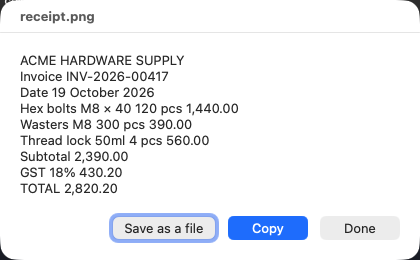
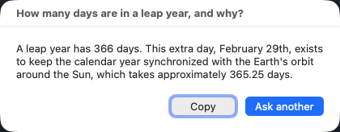

# Apple's built-in AI on macOS 27 (`fm`)

Two small apps and a measurement harness for the Foundation Model that ships inside
macOS 27 at `/usr/bin/fm`. Nothing here downloads a model — the model is already on
your Mac.

Companion code for the article *"Apple Hid a Free AI in macOS 27."*

## For everyone: two apps, no Terminal




| App | What you do | What happens |
|---|---|---|
| **Read Text** | Drag a picture onto it | Pulls the text out, offers to copy or save |
| **Ask the Mac AI** | Double-click it | Type a question, get an answer |

Both live in [`mac-apps/`](mac-apps/) — see [its README](mac-apps/README.md) for the
one-time setup, the Gatekeeper first-launch step, and a build-it-yourself route through
Script Editor if you would rather not run a binary someone else compiled.

**One warning:** do not use this to read QR codes or barcodes. It is right about 6 times
in 10 and its wrong answers look plausible. Use the Camera app.

## For developers

| File | What it does |
|---|---|
| `fmprobe.py` | HTTP probes: context ceiling, `max_tokens`, latency curve, structured output, concurrency, cold start. Standard library only. |
| `fm-native/afminfo.swift` | Which model is actually served, and the `GenerationOptions` surface |
| `fm-native/afmtest.swift` | `contextSize`, `maximumResponseTokens`, quality probes |
| `fm-native/afmperf.swift` | Native streaming latency vs prompt length |
| `fm-native/afmtools.swift` | Tool calling and `@Generable` structured output |
| `fm-native/qrcheck.swift` | The Vision barcode decoder, called directly with no model |
| `fm-native/mkassets.swift` | Generates the test QR code, invoice and chart locally |

```sh
python3 fmprobe.py ceiling        # binary-search the real context limit
swiftc -O fm-native/afminfo.swift -o afminfo && ./afminfo
```

The native Swift probes matter: through the HTTP shim, `max_tokens` is ignored, tool
calling is invisible, and a context-overflow error arrives as an empty HTTP 200. Query
the framework directly for anything you intend to publish.

## Findings these reproduce

- The model served is `instruct_3b` — the 3B dense variant.
- The context window is **8,192 tokens**, not the 4,096 most write-ups state.
  `model.contextSize == 8192`, and bisection brackets it: 8,128 accepted, slightly more rejected.
- `fm count-tokens` undercounts the server by a constant **54 tokens**.
- `fm serve` ignores `max_tokens` (ask 16, get ~1,500); the native API honours it exactly.
- Time to first token depends on how recently you last called it: **0.17 s** back-to-back
  versus **0.60 s** after a ten-second pause.
- `--tool barcode` decodes a QR code correctly **6 times out of 10**, and **0 out of 10**
  if you tell it to use the barcode tool. Called directly, the Vision decoder is right every time.

All figures measured on an M5 Max MacBook Pro running macOS 27.0.1 (26A434). They are
one machine's results, not a universal benchmark.

## Licence

MIT for the code here. Apple's `fm` binary and the model are Apple's, and governed by the
terms you accept with `sudo fm license`.
